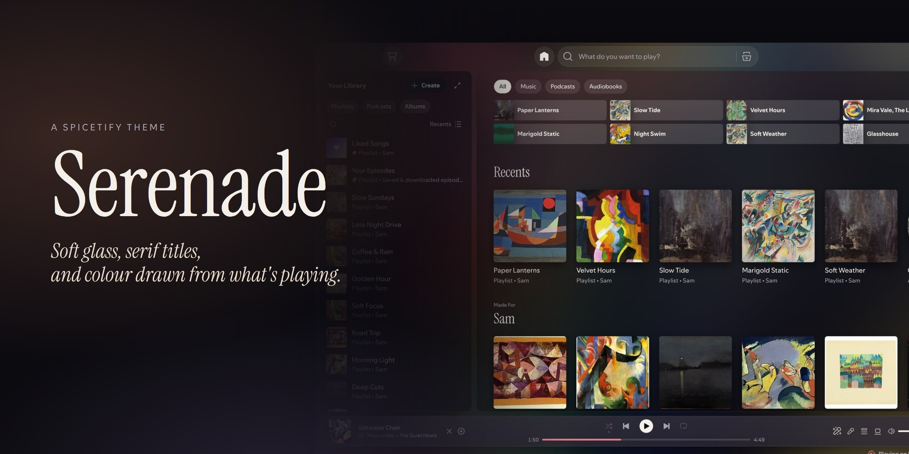
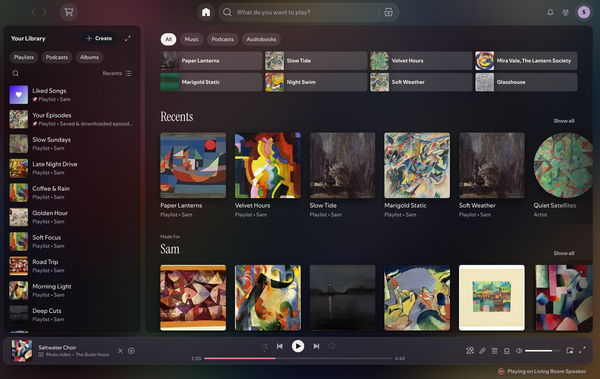
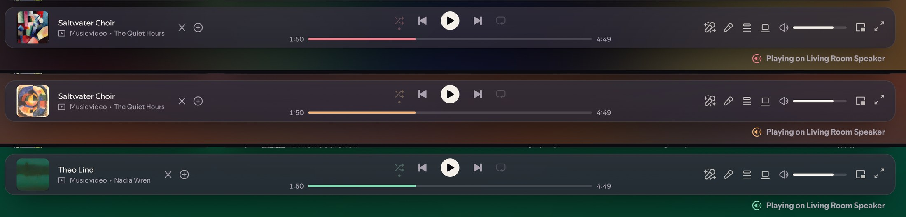
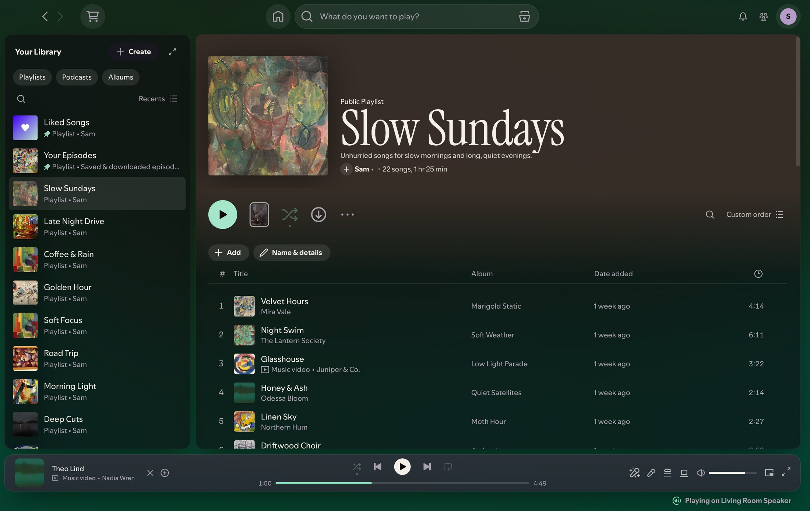

<p align="center">
  
</p>

# Serenade

A soft, serif theme for [Spicetify](https://spicetify.app). Ink-dark glass panels
float over a slow, blurred wash of whatever you're listening to, page titles are set
in an editorial serif, and the accent colour quietly follows the album art.



## What makes it different

- **Ambient backdrop.** The current cover is blurred into the whole window and
  cross-fades when the track changes. It works for local playback and when you're
  controlling another device over Spotify Connect.
- **Accent from the artwork.** Progress bar, buttons and highlights take a colour
  picked from the cover. Black-and-white covers fall back to a warm amber.
- **Contrast that holds up.** The backdrop is measured per cover and darkened only as
  much as needed, so the top bar's controls keep at least 3:1 contrast (WCAG non-text)
  even on bright, saturated covers, while dark covers keep their colour.
- **Serif where it matters.** Playlist, album and artist titles and Home shelf headings
  use [Instrument Serif](https://fonts.google.com/specimen/Instrument+Serif). Everything
  else keeps Spotify's own UI font.
- **Glass all the way down.** Library, main view and sidebar are translucent panels;
  menus are frosted; the player is a floating bar; playlist headers are one even
  colour wash with no seams.
- **Small comforts.** Recents and Made For You move to the top of Home, cards lift
  on hover, and the [Cat Jam](https://github.com/BlafKing/spicetify-cat-jam-synced)
  extension sits neatly inside the player bar.





## Install

### Spicetify Marketplace (recommended)

1. Open **Marketplace** in Spotify (install it from the
   [Marketplace guide](https://github.com/spicetify/marketplace/wiki/Installation) if needed).
2. Go to **Themes**, search for **Serenade**, and click **Install**.

### Manually

```bash
git clone https://github.com/kailingma/spicetify-serenade.git \
  "$(dirname "$(spicetify -c)")/Themes/Serenade"
spicetify config current_theme Serenade color_scheme Ember inject_theme_js 1
spicetify apply
```

On Windows (PowerShell), clone into `$env:APPDATA\spicetify\Themes\Serenade`
and run the same `spicetify config` and `spicetify apply` commands.

## Colour schemes

| Scheme  | Feel |
|---------|------|
| `Ember` | Warm ink with an amber fallback accent (default) |
| `Tide`  | Cool slate with a sea-glass fallback accent |

```bash
spicetify config color_scheme Tide && spicetify apply
```

The fallback accent is only used until a cover has been read, or for covers with
almost no colour.

## Notes

- Tested on Spotify 1.3.4 with Spicetify 2.46. Spotify changes its markup often; if
  something looks off after a Spotify update, please open an issue with a screenshot.
- `inject_theme_js` must be on for the backdrop and dynamic accent. Without it you
  still get the glass, serif and colour scheme.
- Instrument Serif is loaded from Google Fonts. Offline, titles fall back to a
  system serif.
- The Home reordering matches Spotify's English section names. In other languages
  Home keeps Spotify's order.

### Tip for GNOME on Linux

Spotify draws square window corners. The
[Rounded Window Corners Reborn](https://extensions.gnome.org/extension/7048/rounded-window-corners-reborn/)
extension can round them. If you use fractional scaling, switch the extension's
blacklist to **whitelist mode** and add only `Spotify`: Electron and Chromium apps
running natively on Wayland can turn blurry, or gain a 1px edge, when the effect
is applied to them.

## Uninstall

Remove it from Marketplace, or:

```bash
spicetify config current_theme SpicetifyDefault color_scheme "" && spicetify apply
```

## Screenshot credits

All song, artist and playlist names in the screenshots are invented, and every cover is
a public-domain painting (all made before 1930) sourced from Wikimedia Commons: works by
Wassily Kandinsky, Paul Klee, Piet Mondrian, Franz Marc, August Macke, Augusto Giacometti
and James McNeill Whistler. See [CREDITS.md](CREDITS.md) for the individual works.

## License

[MIT](LICENSE)
